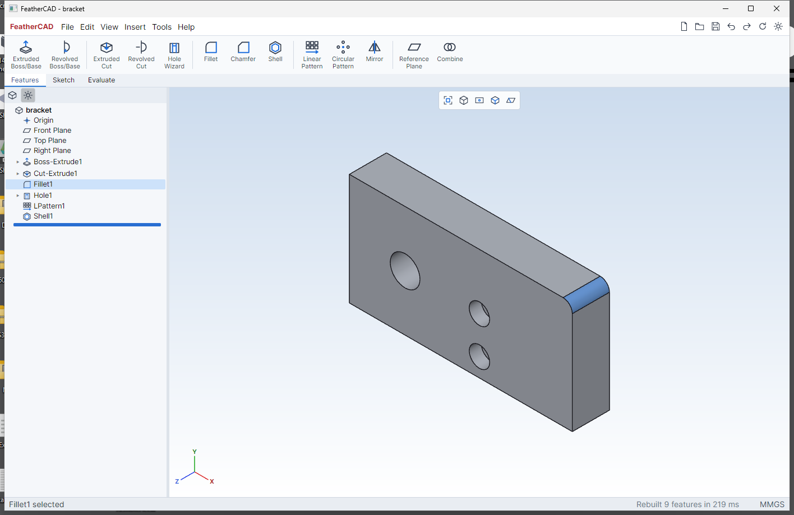

# FeatherCAD

Fast, lightweight, open-source **parametric 3D CAD** with a SolidWorks-style workflow.
Pure C# — its own B-rep geometry kernel, an Avalonia UI and an OpenGL viewport — so it runs
natively on **Windows, Linux and macOS** with no browser, no Electron and no native CAD kernel to install.



## Highlights

- **SolidWorks feel**: CommandManager tabs (Features / Sketch / Evaluate), FeatureManager design tree with
  rollback bar, PropertyManager pages with green-check/red-X and pink "active selection" boxes, confirmation
  corner, heads-up view toolbar, translucent yellow previews, blue/black/red sketch definition colors,
  and SolidWorks mouse/keyboard navigation.
- **Fully parametric**: every feature is regenerated from the history; dimensions and feature values accept
  expressions and global variables (`W = 100`, `W/2 + 5`, `1in`, `sin(30)`).
- **Fast**: incremental rebuilds (only features after the change are rebuilt), background rebuild thread so
  the UI never blocks, live preview while editing, ~1 s cold start for the ReadyToRun build.
- **Light**: ~3 MB of own code; the only dependencies are Avalonia and Silk.NET (OpenGL bindings).
- **Open formats**: native `.fcad` files are readable, diffable JSON; export to **STEP AP214** and **binary STL**.

## Features

| Area | Commands |
|---|---|
| Sketch | Line, Centerline, Corner/Center Rectangle, Circle, Centerpoint/3-Point/Tangent Arc, Polygon, Straight Slot, Point, Trim, Convert Entities, Construction toggle |
| Relations | Automatic (coincident, horizontal/vertical, midpoint, on-entity) plus Horizontal, Vertical, Parallel, Perpendicular, Collinear, Equal, Tangent, Concentric, Coincident, Midpoint, Symmetric, Fix |
| Dimensions | Smart Dimension: length, horizontal/vertical/aligned distance, point–line, parallel lines, radius, diameter, angle; driven (reference) dims; expressions |
| Solver | Numerical constraint solver with minimum-change dragging and degrees-of-freedom analysis (under / fully / over defined) |
| Features | Extruded Boss/Base & Cut (Blind, Through All, Through All–Both, Mid Plane, two directions, merge result), Revolved Boss & Cut, Fillet, Chamfer, Hole Wizard (simple, counterbore, countersink, standard metric sizes, drill point), Shell, Linear Pattern (2 directions), Circular Pattern, Mirror, Reference Plane, Combine (add/subtract/common) |
| Booleans | Union, subtract, intersect between bodies; multi-body parts |
| Tools | Equations / global variables, Mass Properties (volume, area, mass, center of mass, bounding box), Options (units MMGS/IPS, part color, wheel direction, perspective) |
| Files | `.fcad` open/save, autosave + recovery, STEP and STL export |
| View | Standard views (animated), Normal To, zoom to fit, Shaded With Edges / Shaded / Hidden Lines Visible / Wireframe, perspective, planes toggle |

## Controls (SolidWorks defaults)

| Action | Input |
|---|---|
| Rotate | Middle mouse drag (or Alt + left drag) |
| Pan | Ctrl + middle drag, or right mouse drag |
| Zoom | Mouse wheel (at cursor), Shift + middle drag |
| Roll | Alt + middle drag |
| Zoom to fit | `F` |
| View orientation | `Spacebar`, `Ctrl+1..7` (Front, Back, Left, Right, Top, Bottom, Isometric), `Ctrl+8` Normal To |
| Rotate view | Arrow keys (15°), Shift + arrows (90°) |
| Sketch tools | `L` Line, `R` Rectangle, `C` Circle, `A` Arc, `P` Point, `D` Smart Dimension, `T` Trim, `Esc` select/cancel |
| PropertyManager | `Enter` = OK, `Esc` = Cancel |
| Edit | `Ctrl+Z` / `Ctrl+Y`, `Delete`, `Ctrl+B` rebuild, `Ctrl+Q` force rebuild |

Typical workflow: select **Front Plane** → **Sketch** → draw → **Smart Dimension** (type values or `=expressions`)
→ **Exit Sketch** → **Extruded Boss/Base** (the sketch you just finished is picked up automatically) → OK.
Select a face → **Sketch** to sketch on it; select an edge → **Fillet**; select a face → **Hole Wizard**.

## Build and run

Requires the [.NET 10 SDK](https://dotnet.microsoft.com/download).

```bash
dotnet run --project src/FeatherCad.App -c Release
```

Open a sample: `dotnet run --project src/FeatherCad.App -c Release -- samples/bracket.fcad`

### Release builds (self-contained, ReadyToRun for fast startup)

```bash
./publish.sh linux-x64 osx-arm64      # macOS / Linux
```
```powershell
./publish.ps1 win-x64                  # Windows (PowerShell)
```
Output goes to `publish/<rid>/` — copy the folder anywhere and run `FeatherCAD(.exe)`.

### Tests

```bash
dotnet run --project tests/FeatherCad.Tests -c Release
```
The test runner checks kernel booleans (volumes, watertightness), blends, shell, revolve, exporters, the sketch
solver and complete parametric parts (sketch → extrude → cut on face → fillet → hole → pattern → shell →
equation change → save/load round trip).

## Architecture

```
src/FeatherCad.Kernel   Geometry kernel (no dependencies)
  Math/                 Vec2/Vec3, planes, frames, transforms
  Brep/                 Solid / Face (planar loops + exact plane), stitched Topology (vertices, edges, adjacency)
  Csg/                  Plane-based BSP booleans, vertex welding, face merging / T-junction resolution
  Build/                Profiles, extrude, revolve, primitives
  Ops/                  Edge blends (fillet/chamfer), shell
  Tess/                 Ear-clipping triangulation (holes), GPU display meshes
  IO/                   STEP AP214 and STL writers
src/FeatherCad.Core     Parametric layer
  Sketch/               Sketch model, constraint solver, profile (region) extraction
  Model/                Document, features, references (faces/edges/planes), .fcad serialization
  Regen/                Cached incremental regeneration, reference resolution
  Expr.cs               Expression evaluator for dimensions and equations
src/FeatherCad.App      Avalonia desktop UI
  Viewport/             OpenGL renderer (MSAA), camera, picking, selection modes
  Sketcher/             Interactive sketch editor, dimensions, relation glyphs
  UI/                   PropertyManager framework, design tree, dialogs, icons
tests/FeatherCad.Tests  Kernel + core test runner
```

### The kernel

FeatherCAD uses its own **boundary-representation** kernel written for speed and robustness:

- **Exact planes.** Every face carries the exact plane it was built from; booleans split along those
  planes (plane-based geometry) rather than re-deriving planes from rounded vertices, which keeps
  results crack-free and watertight.
- **Topology vs. geometry are separate.** A solid is faces → loops → edges → vertices; each face points to a
  `SurfaceDef` (plane, cylinder, cone, sphere, torus) describing its **true** shape. Curved faces are currently
  stored as fine planar facets *that remember their exact surface* (axis, radius…). That exact data already
  drives smooth shading, hole/boss rim chamfers and fillets and pattern axes, and it is what a future exact
  NURBS/analytic surface back end will use — files will upgrade without changes.
- **Persistent naming.** Faces are named from the feature and sketch entity that created them
  (`F3.S.L7` = side face of extrude F3 from sketch line 7). References to faces/edges use these names plus a
  geometric hint, so fillets and sketches-on-faces survive parameter changes.

### The `.fcad` format

Plain JSON: units, equations, and the ordered feature list with sketches (points, entities, constraints and
dimension expressions). Example:

```json
{
  "format": "FeatherCAD", "formatVersion": 1, "units": "MMGS",
  "equations": [ { "name": "W", "expr": "120" } ],
  "features": [
    { "$type": "sketch", "id": "F1", "name": "Sketch1", "plane": { "std": "Front" }, "sketch": { "...": "..." } },
    { "$type": "extrude", "id": "F2", "name": "Boss-Extrude1", "sketchId": "F1", "end": "Blind", "depth": "20" },
    { "$type": "fillet", "id": "F5", "name": "Fillet1", "radius": "5", "edges": [ { "a": "F2.S.L3", "b": "F2.End", "hint": [100, 60, 10] } ] }
  ]
}
```

## Current limitations / roadmap

- Curved faces are exact in the model but tessellated in geometry (default chord tolerance ~0.05 mm), so STEP
  export writes them as planar facets. **Next:** exact analytic + NURBS surfaces in booleans and STEP.
- Fillet/chamfer support straight edges between planar faces and circular edges of holes/bosses; corners where
  three blended edges meet are mitered rather than rolled-ball blended.
- Shell offsets faces by moving vertices; walls that would touch or self-intersect (e.g. holes closer than twice
  the thickness) can fail.
- Sketch profiles use the union of closed regions; crossing lines must be split with Trim first.
- Not yet: STEP import, assemblies, drawings, sweeps/lofts, draft, sketch fillets, section views.
- Developed and tested on Windows 11. Linux and macOS use the same code (Avalonia + OpenGL) but have not been tested yet.

## License

MIT — see [LICENSE](LICENSE).
