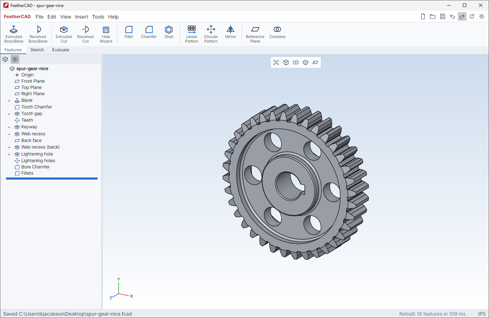

# SpryCAD

Fast, lightweight, open-source **parametric 3D CAD** with a SolidWorks-style workflow.
Pure C# — its own B-rep geometry kernel, an Avalonia UI and an OpenGL viewport — so it runs
natively on **Windows, Linux and macOS** with no browser, no Electron and no native CAD kernel to install.



## Highlights

- **SolidWorks feel**: CommandManager tabs (Features / Sketch / Evaluate), FeatureManager design tree with
  rollback bar, PropertyManager pages with green-check/red-X and pink "active selection" boxes, confirmation
  corner, heads-up view toolbar, translucent yellow previews, blue/black/red sketch definition colors,
  and SolidWorks mouse/keyboard navigation.
- **Fully parametric**: every feature is regenerated from the history; dimensions and feature values accept
  expressions and global variables (`W = 100`, `W/2 + 5`, `1in`, `sin(30)`); conditions on them suppress features
  (`Suppress When Teeth < 30`, and the features using them with them); design tables give rows of values (a
  screw's sizes); user-facing parameters make one part file configurable per instance in assemblies.
- **Fast**: incremental rebuilds (only features after the change are rebuilt), background rebuild thread so
  the UI never blocks, live preview while editing, ~1 s cold start for the ReadyToRun build. A 14-feature
  shelled part (fillets, counterbored holes, pattern, shell, chamfer) rebuilds in ~85 ms; editing one of its
  parameters takes 7–80 ms; tool solids and intermediate results are never meshed, and unchanged boolean
  operands are reused from a cache. A rebuild-time budget test guards against regressions.
- **Light**: ~3 MB of own code; the only dependencies are Avalonia and Silk.NET (OpenGL bindings).
- **Exact geometry**: faces are true planes, cylinders, cones, spheres and tori with exact line, circle and
  B-spline edges — exported to STEP as analytic surfaces and displayed with smooth silhouettes.
- **Rolling-ball fillets between any faces**: where no analytic blend exists (cylinder–cylinder, cylinder–torus,
  plane–tilted cone, …) the fillet is the pipe swept by the ball, its centre solved exactly on the faces'
  offset surfaces (within 1e-8 mm; it reproduces the exact torus of a plane/cylinder fillet to 2e-9 mm), and
  exported to STEP as a fitted B-spline surface. Fillets and chamfers can be patterned and mirrored like cuts.
- **Open formats**: native `.sprt` files are readable, diffable JSON (or a ZIP holding that JSON when a part embeds
  other files); export to **STEP AP214** and **binary STL**.

## Features

| Area | Commands |
|---|---|
| Sketch | Line, Centerline, Corner/Center Rectangle, Circle, Centerpoint/3-Point/Tangent Arc, Polygon, Straight Slot, Point, Trim, Convert Entities, Construction toggle |
| Relations | Automatic while drawing (coincident, horizontal/vertical, midpoint, on-entity) — also to the **existing model**: model vertices (coincident), model edges (on edge), edge midpoints and hole/boss centers, all associative (they follow model changes); dashed inference lines to sketch points and model vertices. Plus Horizontal, Vertical, Parallel, Perpendicular, Collinear, Equal, Tangent, Concentric, Coincident, Midpoint, Symmetric, Fix |
| Dimensions | Smart Dimension: length, horizontal/vertical/aligned distance, point–line, parallel lines, radius, diameter, angle; driven (reference) dims; expressions |
| Solver | Numerical constraint solver with minimum-change dragging and degrees-of-freedom analysis (under / fully / over defined) |
| Features | Extruded Boss/Base & Cut (Blind, Through All, Through All–Both, Mid Plane, two directions, merge result, drafted side walls), Revolved Boss & Cut, Swept Boss & Cut (a profile along tangent lines and arcs, or a circle; exact planes, cylinders, cones, spheres and tori), Helical Boss & Cut (a profile swept along a helix about a centerline, a cylindrical face, an edge or an axis: springs, coils; exact screw surfaces; an optional straight run-out at the end), Thread (ISO metric on a shaft or in a hole: Blind, Up To Next, Through All, a lead-in chamfer, a relief groove or a run-out out of the side, a fit clearance for 3D printing; modeled or cosmetic, with a View override for a lightweight display, exports always modeled), Fillet, Chamfer, Hole Wizard (simple, counterbore, countersink, standard metric sizes, drill point), Shell, Draft (neutral plane: planar faces and round faces along the pull direction, the face names kept), Linear Pattern (2 directions), Circular Pattern, Mirror, Reference Plane, Combine (add/subtract/common) |
| Booleans | Union, subtract, intersect between bodies; multi-body parts |
| Assemblies | `.sasm` assemblies in document tabs (as SolidWorks): components linked to part files or embedded (a small assembly in one file), fixed or floating, lightweight from the assembly's cache; opened from the cached displays when they are of the part's revision and made by the same geometry code (`GeometryVersion`), the rest built in the background and shown as each is done; **mates** (Coincident, Concentric, Parallel, Perpendicular, Tangent, Lock, Distance and Angle with optional limits; mechanical Gear, its ratio from the round faces' diameters, and Screw, its lead per turn; faces of components and the assembly's origin planes) solved together, components dragged only as their mates let them, conflicts shown in red. Parts are found by identity (a GUID each part keeps), wherever they went: renamed, moved, a folder moved; a missing part shows from the cache (its mates still solve) and is listed, never asked about; STEP assemblies open as assemblies (each part embedded once, each use placed as the file has it, locked to the first component) and assemblies export as STEP assemblies |
| Tools | Equations / global variables (internal or user-facing, with limits), Design Tables (pasted from a spreadsheet), Configure, Mass Properties (volume, area, mass, center of mass, bounding box), Options (units MMGS/IPS, part color, wheel direction, perspective) |
| Files | `.sprt` parts and `.sasm` assemblies, open/save, autosave + recovery, slow parts shown at once when opened (their display kept in the file, Options) while they rebuild, exact STEP (analytic surfaces) and STL export |
| View | Standard views (animated), Normal To, zoom to fit, Shaded With Edges / Shaded / Hidden Lines Visible / Wireframe, perspective, planes toggle |

## Controls (SolidWorks defaults)

| Action | Input |
|---|---|
| Rotate | Middle mouse drag (or Alt + left drag); middle double-click = zoom to fit |
| Pan | Ctrl + middle drag, or right mouse drag |
| Zoom | Mouse wheel (at cursor), Shift + middle drag |
| Roll | Alt + middle drag |
| Zoom to fit | `F` |
| View orientation | `Spacebar`, `Ctrl+1..7` (Front, Back, Left, Right, Top, Bottom, Isometric), `Ctrl+8` Normal To |
| Rotate view | Arrow keys (15°), Shift + arrows (90°) |
| Sketch tools | `L` Line, `R` Rectangle, `C` Circle, `A` Arc, `P` Point, `D` Smart Dimension, `T` Trim, `Esc` select/cancel |
| PropertyManager | `Enter` = OK (from any field), `Esc` = Cancel |
| Edit | `Ctrl+Z` / `Ctrl+Y`, `Delete` (confirms, lists dependent features), `F2` rename, `Ctrl+B` rebuild, `Ctrl+Q` force rebuild |

Typical workflow: select **Front Plane** → **Sketch** → draw → **Smart Dimension** (type values or `=expressions`)
→ **Exit Sketch** → **Extruded Boss/Base** (the sketch you just finished is picked up automatically) → OK.
Select a face → **Sketch** to sketch on it; select an edge → **Fillet**; select a face → **Hole Wizard**.

## Build and run

Requires the [.NET 10 SDK](https://dotnet.microsoft.com/download).

```bash
dotnet run --project src/SpryCad.App -c Release
```

Open a sample: `dotnet run --project src/SpryCad.App -c Release -- samples/bracket.sprt`

### Parametric demo models (`samples/demos`)

Every dimension in these parts is an expression of global variables: open **Tools > Equations**, change a
value and the whole part regenerates (sketches, patterns, fillets, holes). Each one is rebuilt by the test suite
as designed and with several variables changed, and exports to a valid exact STEP.

| File | What it shows | Try changing |
|---|---|---|
| `pipe-flange.sprt` | Revolved weld-neck flange, bolt hole circular-patterned on the pitch circle, hub fillet, edge chamfers | `N` (bolt count), `PCD`, `OD`, `HubH`, `BoltD` |
| `enclosure.sprt` | Rounded box, shell, rim fillet, screw bosses (2-D pattern) with holes, vent slots patterned and mirrored to the opposite wall | `L`, `W`, `H`, `Wall`, `VentN`, `VentP` |
| `heat-sink.sprt` | Base plate with N fins whose pitch is derived from N (`(L-T)/(N-1)`), counterbored mounting holes | `N`, `T`, `FinH`, `L` |
| `stepped-shaft.sprt` | Revolved stepped shaft, shoulder fillets, chamfers, rounded-end keyway, cross hole | `D1`, `D2`, `L2`, `KeyW`, `KeyL` |
| `l-bracket.sprt` | Mid-plane extruded L profile, gusset mirrored to both sides, counterbored and plain holes, outer bend fillet | `A`, `Bh`, `Wb`, `T`, `Gs`, `HoleSp` |
| `spur-gear.sprt` | Involute spur gear: one tooth gap (each flank three arcs through exact involute points, within ~2 µm of the true involute at module 2) patterned `z` times, keyed bore, recessed web with lightening holes; derived variables (`rb`, `ra`, `rf`, ...) in the equations | `m`, `z`, `PA`, `b`, `Bore` |
| `hand-wheel.sprt` | Cast-iron hand wheel: round rim, dished (raised) hub, slanted spokes extruded on a plane normal to their centreline, keyed bore, spinner knob on the rim as a separate body | `D`, `Dish`, `NS` (spokes), `SpokeD`, `KnobL` |
| `spoked-handwheel.sprt` | Hand wheel with filleted joints: round rim with finger scallops on its inner side, straight spokes, keyed hub. Every joint is a rolling-ball fillet between curved faces (spoke/rim cylinder–torus, spoke/hub cylinder–cylinder, convex scallop edges), made once on the seed spoke and scallop and patterned with them | `NS` (spokes), `NG` (grips per gap), `D`, `RimT`, `SpokeD`, `Rf` |
| `bent-tube.sprt` | Tube swept along a straight leg, a 90° bend and a second leg (exact cylinders and a torus), bolted flange at its start with a patterned hole circle | `R` (bend radius), `L1`, `L2`, `OD`, `ID`, `N`, `PCD` |
| `bolt-and-nut.sprt` | Printable M10 bolt and nut: hex head and shank threaded by the Thread feature (external), and a separate hex nut threaded through its hole (internal), both with a fit clearance | `D`, `P` (size and pitch), `L`, `Clr` (clearance), `NutH`, `S` |
| `acme-lead-screw.sprt` | Three-start Acme lead screw and its nut: a 29° trapezoidal thread space swept by a Helical Cut of lead N·P and circularly patterned N times about the axis, a journal at one end and a lead-in chamfer at the other; beside it a hex nut (separate body) threaded the same way with the screw's tooth plus a clearance, which fits the screw where it stands | `D`, `P` (pitch), `N` (starts), `L`, `J`, `JL`, `S`, `NutL`, `Clr` |
| `hinge.sasm` | A hinge in one file: two of the same leaf (knuckle along half an edge, notched for the other's) and the pin, all embedded, printable clearances; mated so the second leaf swings about the pin (drag it) | `L`, `W`, `T`, `KD`, `PinD`, `Clr` (in the embedded Leaf) |
| `lead-screw.sasm` | The three-start Acme screw and its nut as two parts (embedded), held by a Screw mate of the thread's 12 mm lead: drag the nut and it turns as it travels, fitting the thread all the way | (in the embedded parts) |
| `gears.sasm` | Two spur gears meshing (0.1 mm backlash), their axes mated to the origin planes and a Gear mate between them: turn one and the other turns the other way | (in the embedded Gear) |
| `configurable-gear.sprt` | The spur gear made configurable: `m`, `z`, `b`, `Bore` user-facing (Tools > Configure), the rest internal; the web recesses suppressed when the web is too narrow (`RimD - HubD < 4*m`), the lightening holes when too small (`LH < 2*m`, and their pattern with them), so small gears come out solid | `z` (20: solid, 26: recessed, 60: holes too) |
| `socket-screw.sprt` | ISO 4762 socket head cap screw, M3 to M12 in one file: a design table of the sizes (`D`, `P`, `dk`, `k`, `s`, `t`), the length `L` and whether the thread shows user-facing | Configure: `Size`, `L`, `Threaded` |
| `screw-sizes.sasm` | The socket screw once (embedded), seven components each configured its own size and length (right-click a component > Configure) | (Configure each component) |

The demos are generated by `tests/SpryCad.Tests/Demos.cs` through the same document API the UI uses
(`dotnet run --project tests/SpryCad.Tests -c Release -- demos samples/demos`).

### Release builds (self-contained, ReadyToRun for fast startup)

```bash
./publish.sh linux-x64 osx-arm64      # macOS / Linux
```
```powershell
./publish.ps1 win-x64                  # Windows (PowerShell)
```
Output goes to `publish/<rid>/` — copy the folder anywhere and run `SpryCAD(.exe)`.

### Installers

Both publish the app, regenerate the demo parts (failing on a broken one) and include the samples; the version
is `<Version>` in `src/SpryCad.App/SpryCad.App.csproj`, or pass one.

```powershell
build/make-installer.ps1               # Windows: publish/SpryCAD-Setup-<version>.exe (needs Inno Setup 6)
```
```bash
build/make-linux-package.sh            # Linux: publish/SpryCAD-<version>-linux-x64.tar.gz (also runs in Git Bash)
```
The Windows setup installs per user by default and opens `.sprt` parts and `.sasm` assemblies with SpryCAD, each with its own icon. On Linux, unpack the
tarball and run `./install.sh`: it installs into `~/.local/share/sprycad` with a menu entry, icon, `.sprt`
file type and a `sprycad` command (`./uninstall.sh` removes them).

CI (`.github/workflows/packages.yml`) publishes every push to master to the **dev** channel and every version tag
to **stable**: a signed apt repository, the downloads, and an update feed (`updates/<channel>.json`), all on
Cloudflare R2; GitHub releases link to the files there. On Debian or Ubuntu (`dev` in place of `stable` for the
latest master build):

```bash
sudo install -d -m 0755 /etc/apt/keyrings
curl -fsSL https://<packages-host>/apt/sprycad-archive-keyring.gpg | sudo tee /etc/apt/keyrings/sprycad.gpg > /dev/null
echo "deb [arch=amd64 signed-by=/etc/apt/keyrings/sprycad.gpg] https://<packages-host>/apt stable main" | sudo tee /etc/apt/sources.list.d/sprycad.list
sudo apt update && sudo apt install sprycad
```

### Tests

```bash
dotnet run --project tests/SpryCad.Tests -c Release
```
The test runner checks kernel booleans (volumes, watertightness), blends, shell, revolve, exporters, the sketch
solver and complete parametric parts (sketch → extrude → cut on face → fillet → hole → pattern → shell →
equation change → save/load round trip), plus a rebuild-time budget on two sample models.

Performance tools:

```bash
# warm/cold rebuild, per-feature times, profile by stage, and the cost of editing each feature's parameter
dotnet run --project tests/SpryCad.Tests -c Release -- bench path/to/model.sprt 10
# rebuild with one parameter changed, writing the boolean trace to %TEMP%/fc-repro-trace.txt
dotnet run --project tests/SpryCad.Tests -c Release -- repro path/to/model.sprt Fillet2 Radius 2.5
```
`Kernel.Prof` is a lightweight stage profiler (`using (Prof.Time("stage")) ...`, off by default).

## Architecture

```
src/SpryCad.Kernel   Geometry kernel (no dependencies)
  Math/                 Vec2/Vec3, planes, frames, transforms
  Brep/                 Solid / Face (planar loops + exact plane), stitched Topology (vertices, edges, adjacency)
  Csg/                  Plane-based BSP booleans, vertex welding, face merging / T-junction resolution
  Build/                Profiles, extrude, revolve, primitives
  Ops/                  Edge blends (fillet/chamfer), shell
  Tess/                 Ear-clipping triangulation (holes), GPU display meshes
  IO/                   STEP AP214 and STL writers
src/SpryCad.Core     Parametric layer
  Sketch/               Sketch model, constraint solver, profile (region) extraction
  Model/                Document, features, references (faces/edges/planes), .sprt serialization
  Regen/                Cached incremental regeneration, reference resolution
  Expr.cs               Expression evaluator for dimensions and equations
src/SpryCad.App      Avalonia desktop UI
  Viewport/             OpenGL renderer (MSAA), camera, picking, selection modes
  Sketcher/             Interactive sketch editor, dimensions, relation glyphs
  UI/                   PropertyManager framework, design tree, dialogs, icons
tests/SpryCad.Tests  Kernel + core test runner
```

### The kernel

SpryCAD has its own **exact boundary-representation kernel** (`Kernel/Native`), written for speed and
robustness:

- **Exact geometry.** A solid is faces → loops → edges → vertices; every face lies on an exact surface and every
  edge on an exact curve. Surfaces: plane, cylinder, cone, sphere and torus (analytic), the rolling-ball pipe of
  a fillet, **B-spline / NURBS** surfaces (rational, periodic, as imported from STEP) and offset surfaces. Curves:
  line, circle, ellipse, B-spline, and curves defined on surfaces (fillet contact lines, cross sections,
  iso-parameter lines). Facets exist only for display, thumbnails and mesh export.
- **Analytic and NURBS side by side.** This is the same choice Parasolid and ACIS make: analytic surfaces are
  exact, compact and fast (closed-form intersections, no fitting error), and NURBS covers everything else.
  The algorithms above the surface layer (booleans, fillets, shell, tessellation, STEP) work on both through
  one surface interface, so a new surface type plugs in without changing them, and nothing built on today's
  surfaces is lost if more of the kernel moves to NURBS later.
- **Booleans** split edges where they cross the other body, compute section curves (analytically for
  analytic pairs, otherwise traced on both surfaces and fitted within tolerance), split faces in their
  parameter domains, classify the pieces exactly, and sew. They are **local**: faces and edges far from the
  tool are skipped by every stage, so the cost follows the size of the change, not of the part.
- **Fillets** are rolling-ball blends built from the exact faces: the ball centre runs along the
  intersection of the faces' offset surfaces, and the blend is the pipe around it. Edges whose faces change
  tangentially (a groove's rim running from the rim onto a spoke fillet) get one tool, with the ball rolling
  from face to face. Lines and arcs between planes and cylinders use extruded/revolved profiles. **Shell**
  offsets every face exactly.
- **Patterns** copy the seed's tool where an instance's geometry is the seed's moved, and solve fillets and
  chamfers again where it is not.
- **Data exchange.** STEP export writes the exact faces (analytic surfaces, NURBS, offset surfaces; fillet
  pipes as fitted B-splines). STEP import reads exact solids, splits faces that wrap around periodic
  surfaces, and corrects face orientation from the loops. Exported files are checked with OpenCascade's
  B-rep checker (valid closed solids, exact volumes).
- **Persistent naming.** Faces are named from the feature and sketch entity that created them
  (`F3.S.L7` = side face of extrude F3 from sketch line 7). References to faces/edges use these names plus a
  geometric hint, so fillets and sketches-on-faces survive parameter changes.
- An older faceted kernel (`Kernel/Brep`, `Kernel/Csg`) remains as a fallback for the few operations the
  exact kernel cannot do yet.

### The `.sprt` format

SpryCAD files: `.sprt` parts, `.sasm` assemblies, and `.sdrw` (reserved for drawings). The app icon and the
file type icons are drawn by `build/make-icon.ps1`.

A part is a JSON document: units, the part colour, equations, and the ordered feature list with sketches
(points, entities, constraints and dimension expressions). Features store what was asked for (expressions,
face and edge references by persistent name plus a hint point), never computed geometry: the model is rebuilt
on open. An `.sprt` file is either this JSON as plain text, or a container (below) that holds it as
`model.json`. Example:

```json
{
  "format": "SpryCAD", "formatVersion": 1, "units": "MMGS",
  "equations": [ { "name": "W", "expr": "120" } ],
  "features": [
    { "$type": "sketch", "id": "F1", "name": "Sketch1", "plane": { "std": "Front" }, "sketch": { "...": "..." } },
    { "$type": "extrude", "id": "F2", "name": "Boss-Extrude1", "sketchId": "F1", "end": "Blind", "depth": "20" },
    { "$type": "fillet", "id": "F5", "name": "Fillet1", "radius": "5", "edges": [ { "a": "F2.S.L3", "b": "F2.End", "hint": [100, 60, 10] } ] }
  ]
}
```

A part that embeds other files (e.g. an imported model) is saved as a **container**: a ZIP archive with the same
JSON as `model.json`, the embedded files under `attachments/` (listed with size and SHA-256 in `model.json`, and
verified on open) and a `thumbnail.png` preview. Its first entry is an uncompressed `mimetype`
(`application/x-sprycad-part`; assemblies, always containers, `application/x-sprycad-assembly`), as in ODF and EPUB,
so tools that recognize files by content can tell them apart without unzipping. Options → "Always save parts as
containers" saves every part that way. Both kinds use the `.sprt` extension and are told apart by their first bytes.
To diff containers in git:

```bash
git config diff.sprt.textconv 'sh -c "unzip -p \"$0\" model.json 2>/dev/null || cat \"$0\""'
# and in .gitattributes:  *.sprt diff=sprt
```

## Current limitations

- Shell keeps the faces and edges of the part and moves them: when the inner surface changes shape at the wall
  thickness (a fillet or hole closer to another face than the wall is thick) it fails with an explanation.
- Corners where three fillets meet are not blended yet; chamfers on curved face pairs are not supported.
- STEP import reads exact solids (analytic and B-spline faces); assemblies, surfaces of revolution/extrusion
  and open surface models are not imported yet.
- Sketch profiles use the union of closed regions; crossing lines must be split with Trim first.
- Developed and tested on Windows 11. Linux and macOS use the same code (Avalonia + OpenGL) but have not been
  tested yet.

## Roadmap

Check items off as they land.

### Kernel performance

- [x] Local booleans: work only on the faces near the tool instead of the whole body (rebuild time follows
      the size of the change, not of the part)
- [ ] Reuse face splits and edge samples of faces a boolean leaves untouched (face domains and edge
      bounds are reused)
- [ ] Analytic intersections for more pairs (plane/torus, cylinder/sphere, oblique cone/plane, ...)
- [ ] Pattern copies that do not touch: copy the topology instead of running booleans
- [x] Pattern copies that touch: a union of copies that is an earlier union moved (copies 2-3 are 0-1 turned) is moved and renamed, not made again
- [ ] Recognise B-spline faces that are planes, cylinders or cones on import (sheet-metal STEP files)
- [ ] Faster B-spline closest point (better seeds, fewer Newton steps) and adaptive traces between B-splines
- [ ] Display normals from the tessellator's parameters; reuse unchanged faces' meshes; level of detail
- [ ] Fewer surviving allocations per operation (clone of a 3000-face body triggers gen-1 GCs)
- [ ] Rolling-ball spine at 1e-6 instead of 1e-8; independent fillet chains in parallel

### Modelling

- [x] Sweep along a tangent path of lines and arcs (or a circle), boss and cut
- [x] Helical sweeps and modelled threads (exact screw surfaces; ISO metric, end conditions, lead-in chamfers, relief grooves and run-outs, fit clearance)
- [ ] Sweep along splines and 3D paths, twist and guide curves; loft (sections, guide curves)
- [ ] Cosmetic threads (annotation only), thread standards beyond ISO coarse (fine, UNC/UNF, pipe), tapered threads
- [x] Draft (neutral plane; drafted extrudes)
- [ ] Draft: parting line and step draft; drafting faces next to fillets with them
- [ ] Smooth corner blends where three fillets meet (setback / vertex blends)
- [x] Fillets along edges that run across tangent faces (the ball rolls from face to face in one tool)
- [x] Patterned fillets solved again on instances whose geometry differs from the seed
- [ ] Variable-radius and face fillets; chamfers on curved faces
- [ ] General shell / offset that survives topology changes; thicken; offset surface bodies
- [ ] Surface modelling: open surface bodies, knit, trim, extend, fill / patch, ruled and boundary surfaces
- [ ] Fit traced section curves to the size of the face pair, not of the whole operand (a big pattern cut
      leaves coarse curves that later local booleans must reconcile: handwheel spokes at 220-250 degrees)
- [ ] Boolean robustness for the remaining tangent and partial-overlap cases (fillets of neighbouring features that
      overlap each other, cuts with fillets running through other fillets)
- [ ] Body edits: split body, move / delete / replace face with healing
- [ ] Sheet metal: flanges, bends with K-factor, flat pattern

### Geometry and topology

- [ ] Swept / extruded / revolved surfaces (also in STEP import); true offset curves
- [ ] Tolerant modelling (per-edge and per-vertex tolerances) for imperfect imported geometry
- [ ] General curve/curve and curve/surface intersector
- [ ] Healing on import (gaps, slivers, orientation; orientation from loops is done)
- [ ] Non-manifold, sheet and wire bodies
- [ ] Persistent naming through all splits and merges

### Analysis

- [x] Exact mass properties (integrated on the surfaces, not the mesh)
- [ ] Minimum distance, curvature analysis, interference detection
- [ ] Section views / exact planar slices

### Data exchange

- [x] STEP import of exact solids (analytic and B-spline faces)
- [x] Embedded files in .sprt containers
- [x] STEP assemblies (placed instances: imported as assemblies, exported from them)
- [ ] STEP colours and layers; AP242 with PMI
- [ ] IGES and Parasolid (x_t)
- [ ] File-format plugins (import/export registry, plugins loaded on first use)

### Beyond the kernel

- [ ] Assemblies and mates (done: components, part identity, linked and embedded parts, missing-part handling, standard mates; next: interference detection, editing embedded parts, STEP assemblies)
- [ ] Drawings with hidden-line removal
- [ ] Configurations
- [ ] Scripting API

## License

MIT — see [LICENSE](LICENSE).
